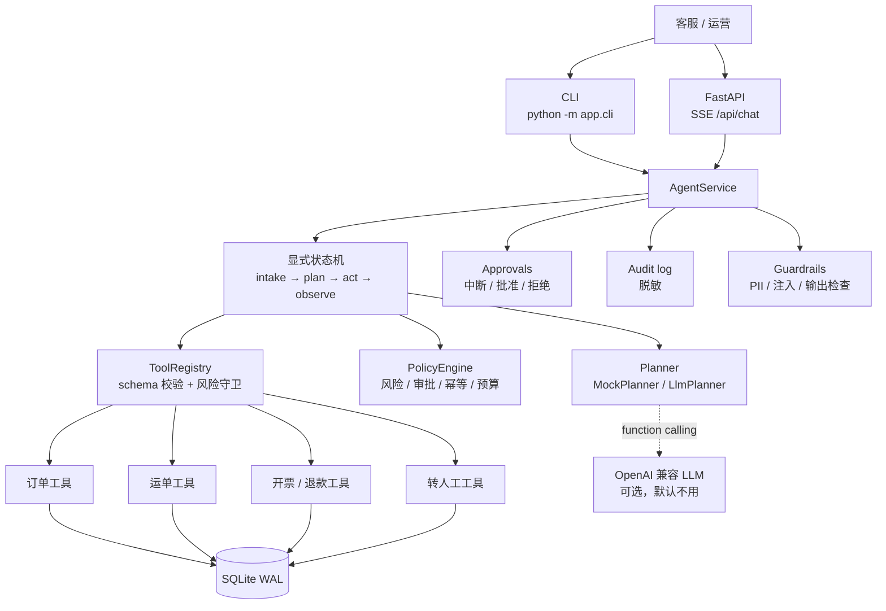
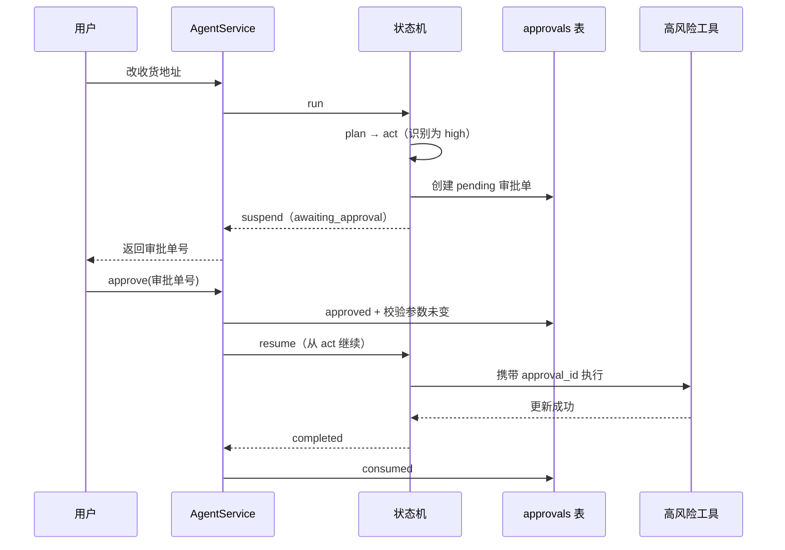

# 物流业务 Agent 服务

把订单、运单、发票等内部接口封装成工具，让 Agent 通过 function calling 编排查询与操作；
改地址、取消订单、改派、退款四类高风险动作在真正执行前强制进入人工审批。

这个仓库是一个可离线跑通的后端项目：不需要网络、不需要 API Key，也不依赖 LangChain。
它面向一个很具体的问题：客服处理一单售后，通常要在订单、履约、开票、客服工单四个后台之间来回切换。

## 特性

- **离线可跑**：默认 `PLANNER=mock`，规则规划器是确定性的；demo、测试、评测都不联网。
- **核心零第三方依赖**：只有 Python 标准库。FastAPI 是可选部署外壳，缺失时给出明确提示。
- **显式状态机**：`intake → plan → act → observe → respond | escalate | fail`，高风险时在 `act` 中断，审批后从同一状态恢复。
- **工具契约统一**：注册表包含 schema 校验、风险等级、幂等标记；手写校验器覆盖常用 JSON Schema 子集。
- **审批不可绕过**：policy、registry、工具实现、service 四层检查，`high` 风险工具没有审批上下文会抛 `ApprovalRequired`。
- **可审计**：每次 Agent 工具调用写 SQLite，参数和结果摘要做 PII 脱敏；CLI 可直接看表格。
- **可评测**：40 条 JSONL 用例，包含口语省略、复合意图、相似工具、注入、非法参数等难例；指标见 [EVAL_REPORT.md](docs/EVAL_REPORT.md)。

## 架构



状态机与 LangGraph 的对应关系（详见 [DESIGN.md](docs/DESIGN.md)）：

| 本项目 | LangGraph 概念 |
| --- | --- |
| `AgentState` + `runs.state_json` | State + checkpointer |
| `intake / plan / act / observe` | 节点（node） |
| 节点返回下一节点名 | 条件边（conditional edge） |
| `awaiting_approval` + `approvals` 记录 | `interrupt` |
| `AgentGraph.resume()` | 用同一 thread / checkpoint 恢复 |

审批中断的时序：



## 工具清单

| 工具 | 业务域 | 风险 | 审批 | 幂等 | 说明 |
| --- | --- | --- | --- | --- | --- |
| `query_order` | 订单 | 低 | 否 | 否 | 按订单号查状态、金额、地址、关联运单 |
| `list_orders` | 订单 | 低 | 否 | 否 | 按状态 / 手机号查订单列表 |
| `change_delivery_address` | 订单 | **高** | **是** | 否 | 修改未发货订单的收货地址 |
| `cancel_order` | 订单 | **高** | **是** | 否 | 取消未发货订单 |
| `track_shipment` | 运单 | 低 | 否 | 否 | 查物流轨迹与最新节点 |
| `estimate_delivery` | 运单 | 低 | 否 | 否 | 预计送达时间 |
| `reroute` | 运单 | **高** | **是** | 否 | 在途运单改派地址 |
| `query_invoice` | 发票 | 低 | 否 | 否 | 按发票号或订单号查发票 |
| `create_invoice` | 发票 | 中 | 仅 conservative | **是** | 开票；同一幂等键只出票一次 |
| `refund` | 发票 | **高** | **是** | 否 | 已开票订单全额退款 |
| `escalate_to_human` | 工单 | 低 | 否 | 否 | 记录原因，生成人工工单 |

风险分级规则、审批状态机与审计字段见 [POLICY.md](docs/POLICY.md)。

## 快速开始

要求 Python 3.11+，在项目根目录执行。核心命令不需要安装任何依赖：

```powershell
python -m app.demo
python -m unittest discover -s tests -v
python -m app.cli eval
```

`python -m app.demo` 会打印三个场景的完整轨迹：

1. 查订单 + 查轨迹：看规则规划器如何从订单结果补全运单号；
2. 改收货地址：高风险中断，展示审批单，再 `approve` 恢复执行；
3. 知识库外问题：不猜测参数，转人工并生成工单。

其他 CLI 命令：

```powershell
# 单条执行；高风险时会打印审批单号
python -m app.cli run "查一下订单 SH20250001 的物流"
python -m app.cli run "我的订单 SH20250006 收货地址改成杭州市滨江区江南大道 88 号"

# 批准 / 拒绝审批单（会复用本地 SQLite 中的运行状态）
python -m app.cli approve appr_xxxxxxxxxxxxxxxx
python -m app.cli reject appr_xxxxxxxxxxxxxxxx --reason "客户身份未核验"

# 审计日志（参数和地址摘要已脱敏）
python -m app.cli audit --limit 20
python -m app.cli tools
```

### 可选 HTTP API

FastAPI 不是核心依赖。需要接口时再安装：

```powershell
python -m pip install -r requirements.txt
uvicorn app.api.app:create_app --factory --reload --port 8000
```

```text
GET  /healthz
GET  /api/tools
POST /api/chat                  # SSE: step / tool_result / approval_required / done
POST /api/approvals/{id}        # {"approved": true, "approver": "supervisor"}
GET  /api/approvals/{id}
GET  /api/audit?limit=20&run_id=...
GET  /api/runs/{run_id}
```

`POST /api/chat` 的返回是 SSE。参数示例：

```json
{"message": "查一下订单 SH20250001 的物流", "session_id": "sess_demo"}
```

高风险请求会在流里返回 `event: approval_required`，前端拿到 `approval_id` 后调用审批接口。

### Docker

```powershell
docker compose up --build
```

默认 `PLANNER=mock`，数据卷挂载到 `./data`，浏览器访问 `http://127.0.0.1:8000/healthz`。

## 配置

配置从环境变量读取；项目根目录的 `.env` 提供默认值（不覆盖已有环境变量）。完整示例见 [.env.example](.env.example)。

| 变量 | 默认值 | 说明 |
| --- | --- | --- |
| `PLANNER` | `mock` | `mock` 离线规则；`llm` 使用 OpenAI 兼容接口 |
| `DB_PATH` | `data/logistics.db` | SQLite 路径 |
| `MAX_STEPS` | `8` | 单次运行最大工具执行步数 |
| `TIME_BUDGET_SECONDS` | `20` | 单次运行时间预算 |
| `APPROVAL_POLICY` | `high_only` | `high_only` / `conservative`（medium 也审批） |
| `AUDIT_MASK_PII` | `true` | 审计摘要是否脱敏 |
| `LLM_BASE_URL` | `https://api.deepseek.com/v1` | OpenAI 兼容 base URL |
| `LLM_API_KEY` | 空 | `PLANNER=llm` 时必填 |
| `LLM_MODEL` | `deepseek-chat` | 模型名 |
| `LLM_TIMEOUT_SECONDS` | `15` | LLM 请求超时；失败自动降级到 MockPlanner |

DeepSeek / Qwen 都是 OpenAI 兼容协议，例如 Qwen：

```dotenv
PLANNER=llm
LLM_BASE_URL=https://dashscope.aliyuncs.com/compatible-mode/v1
LLM_API_KEY=sk-...
LLM_MODEL=qwen-plus
```

真实 LLM 只在显式切换时启用；离线 demo、测试和评测完全不依赖网络。

## 风险分级与 HITL

| 等级 | 典型操作 | 默认策略 |
| --- | --- | --- |
| 低 | 查订单、查运单、查发票、转人工 | 直接执行 |
| 中 | 开票（幂等） | 默认直接执行；conservative 模式走审批 |
| 高 | 改地址、取消订单、改派、退款 | **始终人工审批，不可通过配置关闭** |

高风险工具的保护是分层的：

1. `PolicyEngine` 判定必须审批，状态机在 `act` 创建 `approvals` 记录并 suspend；
2. 审批恢复前校验审批单属于当前 run、工具名和参数未变化；
3. `ToolRegistry` 没有 `approval_id` 直接抛 `ApprovalRequired`；
4. 工具实现内部再检查一次 `ToolContext.approval_id`。

同一审批单只会被执行一次：执行成功后状态变为 `consumed`，再次 `approve` 会报冲突。

## 评测结果

最新一次离线评测（`python -m app.cli eval`，40 条用例，MockPlanner）：

| 指标 | 结果 | 口径 |
| --- | ---: | --- |
| 工具选择准确率 | **87.5%** | 工具序列完全一致 35/40 |
| 参数抽取准确率 | **88.9%** | 期望字段逐项匹配 48/54 |
| 审批触发正确率 | **100.0%** | 审批产生与否 40/40 |
| 任务完成率 | **82.5%** | 工具序列 + 关键参数 + 最终状态全部正确 33/40 |

失败集中在：复合意图只执行一部分、12 位订单号被截断、同一工具多实体只取首个、
订单号与运单号同时出现时槽位绑定错误，以及查无此单后没有升级人工。
逐条期望 / 实际 / 可能原因见 [EVAL_REPORT.md](docs/EVAL_REPORT.md)。

评测口径说明：

- MockPlanner 的规则是**通用意图 + 槽位匹配**，不是照着 `data/eval_cases.jsonl` 反写的；
  难例保留下来就是为了暴露规则规划器的真实上限。
- LLM planner 未纳入离线回归：它需要外部模型和网络，只在单元测试里验证请求解析与失败降级。
- 每条用例使用独立 SQLite 和全新种子数据；预期需要审批的用例由评测脚本自动 `approve()`。

## 项目结构

```text
app/
├── agent/         显式状态机、节点、策略、Mock/LLM 规划器
├── api/           FastAPI factory、SSE 路由、Pydantic schema
├── backend/       SQLite 连接、schema.sql、30 条种子订单
├── tools/         注册表、参数校验、订单/运单/开票/退款/转人工
├── audit.py       审计读写与 CLI 表格
├── config.py      环境变量与 .env
├── demo.py        三个离线演示场景
├── eval.py        评测与 Markdown 报告
├── guardrails.py  PII 脱敏、注入检测、输出泄漏检查
├── models.py      dataclass 数据模型
└── service.py     会话、审批、审计、SQLite 持久化
data/eval_cases.jsonl   40 条评测用例
docs/                   DESIGN / POLICY / EVAL_REPORT
tests/                  unittest，API 测试自动 skip
```

## 已知限制

- MockPlanner 是规则系统，不做真正的语义理解；复合意图和多实体抽取会失败，评测里保留了这些失败。
- LLMPlanner 目前只负责“首轮规划”，没有实现完整的反思式多轮 ReAct；网络失败会降级到 Mock。
- SQLite 适合单实例演示，不是多副本生产方案；审批与工具执行之间没有分布式事务。
- 退款只更新本地发票状态，没有对接真实支付/财务系统，也没有外部回滚。
- 审批人身份是 demo 级字段，没有接入 SSO / RBAC / 电子签名。
- PII 脱敏基于正则，不能替代 DLP；输出泄漏检查只覆盖有限标记。
- 时间预算在节点/步骤粒度检查，不是每个工具的执行级硬超时。
- 数据全部是合成种子数据，不包含任何真实客户信息。

## 参考项目

- [Xander-Xai/Customer-Service-AI-Agent](https://github.com/Xander-Xai/Customer-Service-AI-Agent)
- [Keviniscool-boy/agents-on-duty](https://github.com/Keviniscool-boy/agents-on-duty)
- [langchain-ai/langgraph](https://github.com/langchain-ai/langgraph)

只借鉴了“客服工具编排 + 中断恢复 + 审计”的架构思路与问题意识；
本仓库的状态机、工具层、策略、评测和全部代码均为独立实现，未复制上述项目源码。

## English Summary

`logistics-ops-agent` is an offline-runnable logistics operations agent. It exposes order,
shipment, invoice and handoff operations as validated tools, plans tool calls with a deterministic
rule-based planner by default, and suspends high-risk actions for human approval. The core requires
only the Python standard library; FastAPI is optional. A 40-case evaluation deliberately includes hard
cases (compound intents, truncated IDs, entity ambiguity) and reports the real rule-planner limits
rather than a perfect score. An OpenAI-compatible LLM planner is included but is not part of the
offline regression suite.

## License

MIT. Copyright (c) 2025 Yu Xiaodong. See [LICENSE](LICENSE).
